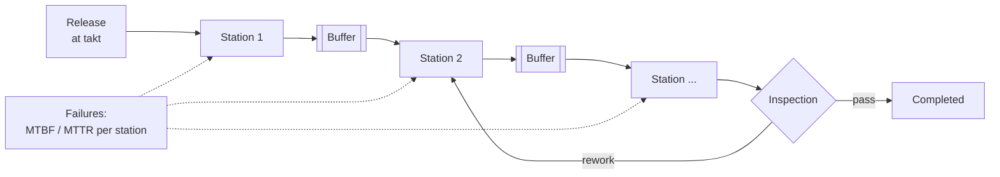

# Blueprint: Assembly line simulation for rate ramp-up

Technical design for this project. The backlog lives in the [epic](https://github.com/stephanyalves-eng/p3-assembly-line-simulation/issues/1); each section below names the issues that deliver it.

## 1. Business question

Can a subassembly line support the move from 42 to 47 aircraft per month, and which intervention closes the gap at the lowest cost per additional unit?

**Decision supported:** which improvement to fund first (rebalancing, an extra buffer, standard work, or maintenance) to reach the new rate.

**Public anchor:** Boeing's Q2 2026 10-Q describes the 737 transition from 42 to 47 per month and a new line in Everett. The line modeled here is fictional: an electrical distribution panel, 4 units per aircraft, so demand rises from 168 to 188 units per month. Swapping aircraft per month for jobs per hour adapts the same model to an automotive line.

## 2. Scope

| In scope | Out of scope |
|---|---|
| One fictional subassembly line with ~25 tasks | Boeing data beyond the public rate figures |
| Takt, line balancing (RPW), discrete-event simulation in SimPy | Supplier delays upstream of the line |
| 5 scenarios with replications and confidence intervals | Labor scheduling and overtime rules in detail |
| OEE and Theory of Constraints on the bottleneck, VSM current and future, A3 | Real cost data (costs are fictional and stated) |

## 3. KPIs and acceptance

| KPI | Definition | Target / check |
|---|---|---|
| Throughput | Units completed per month, mean and 95% CI over 30 replications | ≥ 188 units/month at the 47 rate |
| Lead time | Time from release to completion | Reported per scenario |
| WIP | Average units in the line | Consistent with Little's Law |
| Balance efficiency | Σ task times / (stations × cycle time) | Current vs. proposed balance |
| Bottleneck OEE | Availability × performance × quality at the bottleneck | Loss Pareto by category |
| Cost per additional unit | Intervention cost / extra units per month | Ranks the scenarios |

## 4. Data sources

| Source | What it provides | Access | Use |
|---|---|---|---|
| [Boeing 10-Q Q2 2026 (SEC EDGAR)](https://www.sec.gov/Archives/edgar/data/0000012927/000162828026050038/ba-20260630.htm) | 737 rate transition 42 → 47 per month | Public filing | Demand anchor only |
| Fictional line definition | ~25 tasks with mean, standard deviation and precedence; MTBF, MTTR and rework rate per station | `data/line_definition.yaml` | Committed, documented |
| Fictional costs | Cost of each intervention | `data/intervention_costs.yaml` | Committed, documented |

**Working-time assumption to confirm in #2:** 21 working days, 2 shifts of 7.5 net hours, so 315 hours per month. Takt is then about 112 minutes per unit at 168 units and about 100 minutes per unit at 188 units.

## 5. Model structure



Each station is a SimPy resource with stochastic task times, failures drawn from MTBF and MTTR, finite buffers that block upstream when full, and a rework loop. Runs use a warm-up period and 30 replications per scenario.

## 6. Method by stage

| Stage | Issues | Method | Output |
|---|---|---|---|
| Line data | #2 | ~25 tasks with times and precedence; MTBF, MTTR and rework rate per station | `data/line_definition.yaml` |
| Current-state VSM | #3 | VSM with lead time and value-added ratio (Mermaid in the README or draw.io) | `reports/vsm_current` |
| Takt and balancing | #4 | Takt at 42 and 47 per month; theoretical minimum stations; Ranked Positional Weight heuristic; balance efficiency and smoothness index, current vs. proposed | `src/balancing.py` |
| Base simulation | #5 | SimPy model: stations, finite buffers, failures and repairs, rework loop, shifts | `src/simulation.py` |
| Validation | #6 | Little's Law (WIP = throughput × lead time) and an M/M/1 case against its closed-form solution | Validation notebook, tests |
| v0.1 | #7 | VSM, balancing and validated base model | v0.1 release |
| Scenarios | #8 | A base; B rebalanced; C extra buffer before the bottleneck; D 30% less variability (standard work); E 40% lower MTTR (TPM, SMED); throughput with 95% CI | Scenario table |
| Cost comparison | #9 | Fictional cost of each intervention divided by extra units per month | Ranked scenarios |
| OEE and bottleneck | #10 | OEE per station from the simulation; loss Pareto; 5 focusing steps of TOC on the bottleneck | OEE chart |
| Future state | #11 | Future-state VSM and a 1-page A3 with the recommendation | `reports/A3.pdf` |
| Delivery | #12 | README case study, optional short simulation GIF | v1.0 release |

## 7. Repository layout

```
data/
  line_definition.yaml         # tasks, times, precedence, MTBF, MTTR, rework
  intervention_costs.yaml
src/
  takt.py
  balancing.py                 # RPW heuristic, efficiency, smoothness index
  simulation.py                # SimPy model
  scenarios.py                 # A to E, replications, confidence intervals
  oee.py
notebooks/
  01_balancing.ipynb
  02_validation.ipynb
  03_scenarios.ipynb
reports/vsm_current, vsm_future, A3.pdf
tests/                         # takt, RPW, Little's Law and M/M/1 checks
```

## 8. Validation and tests

- **M/M/1 check:** with exponential arrivals and service, the simulated mean queue length and waiting time must match the closed-form values within the 95% CI.
- **Little's Law check:** WIP, throughput and lead time from the same run must satisfy WIP = throughput × lead time within simulation noise.
- **Balancing check:** RPW on a textbook example must reproduce the published station assignment.
- **Determinism:** a fixed seed gives identical results, so every figure in the README can be reproduced.
- CI runs `ruff check`, `ruff format --check` and `pytest` on every PR.

## 9. Deliverables and releases

| Release | Milestone | Content |
|---|---|---|
| v0.1 | Sprint 5 (ends 14 Feb 2027) | Current-state VSM, takt, balancing, validated base model |
| v1.0 | Sprint 6 (ends 28 Feb 2027) | Scenarios with CI, cost per unit, OEE, TOC, future-state VSM, A3, case study |

## 10. Assumptions and risks

| Item | Mitigation |
|---|---|
| Task times and failure rates are fictional | Keep them in one YAML file, state the ranges and run a sensitivity check |
| Too few replications give overlapping intervals | Start at 30 and increase if the CI half-width hides scenario differences |
| Warm-up bias in the first days | Choose the warm-up from a Welch plot and drop it from the statistics |
| Carnival week (8–10 Feb 2027) shortens Sprint 5 | Protect the base model and validation; the VSM drawing can slip to Sprint 6 |

## 11. Division of work with AI

Claude structures the SimPy code and the validation tests. The line data, the choice of scenarios and the A3 recommendation are mine. The argument I want to defend in interviews is the comparison, for example that scenario D delivers the same capacity as C at a lower cost per unit, more than the code itself.
